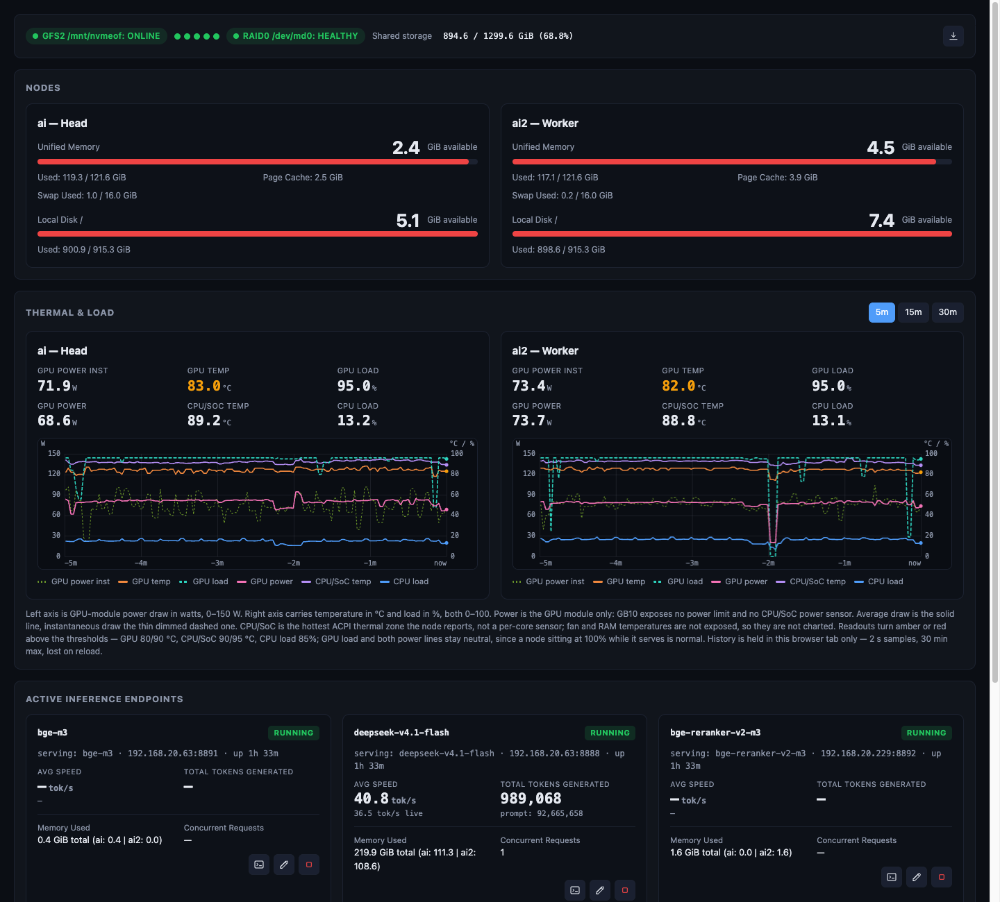

# chronos

Lightweight dashboard suite for a 2-node NVIDIA DGX Spark (Grace Blackwell GB10) cluster (`ai` head + `ai2` worker). One shared domain core, two frontends:

```
chronos/
├── crates/core   — domain logic: registry, GB10 memory attribution,
│                   4-engine telemetry, detached lifecycle
├── crates/tui    — chronos: ratatui terminal dashboard + --dump-state
├── crates/http   — chronos-http: axum web dashboard (:8090) + embedded UI
└── crates/embed  — chronos-embed (:8891) & chronos-rerank (:8892): fastembed CPU models
```



## What it does

- **Unified memory + disk gauges** — per-node `MemTotal/Available/Cache/Swap` and root-disk use with explicit Available.
- **Docker service status & control** — live `docker.service` status checking on both nodes (`ai` and `ai2`) with start controls.
- **Live thermal & power telemetry** — per-node GPU and CPU/SoC temperature, GPU load, GPU power draw (average + instantaneous) and CPU load, charted in the web UI over 5/15/30-minute windows with W and °C/% axes. Threshold colouring for GPU/CPU temperature and CPU load; fan and RAM sensors are not exposed on GB10, so they are not charted.
- **GB10-correct per-server memory** — `docker stats`/`VmRSS` miss ~98 GiB of CUDA unified memory, so memory = `nvidia-smi --query-compute-apps` (GPU MiB) + `/proc/<pid>/status` RSS, attributed via docker cgroup scopes and `process_match`.
- **4-engine telemetry, normalized** — TensorFold (`/health`), vLLM (`/v1/models` + Prometheus `/metrics`, status-checked), veloGB10 (`/health` MTP/dflash2), rust-embed (OpenAI-compatible `/v1/models`): concurrent requests, live tok/s, lifetime decode tok/s, total tokens.
- **Detached lifecycle** — start/stop run in their own session (`process_group(0)`, logs → `logs/<id>.log`); quitting the TUI or restarting the service never touches running inference servers. One active `primary-llm` slot guard.
- **Shared registry** — both frontends see the same entries (`data/registry.json`, seeded with the cluster's 5 launchers on first run).

## The two frontends

**TUI** — 4-zone ratatui dashboard: top status bar, dual-node memory/disk gauges, active-endpoint telemetry, registry table. Keys: `j/k` select · `s` start · `x` stop (`y/n`) · `l` logs · `a` add (auto-detects `launch.sh`/`start-*.sh`/`launch_*.sh` + `.env*`) · `e` edit · `d` remove · `c` drop caches · `r` refresh · `q` quit (leaves servers running).

```bash
chronos
chronos --dump-state | jq .   # headless JSON snapshot, exit 0
chronos wait-idle --for 60s   # block until the GPU entry is idle, then exit 0
```

`wait-idle` is the precondition gate for agent/cron work that shares the GPU: exit `0` only after the `primary-llm` entry has held 0 concurrent / 0 queued / ~0 tok/s for the whole window (2 s samples, fail-closed on missing telemetry). Exit `1` = do not proceed, `2` = unknown entry. See [AGENTS.md](AGENTS.md) for details.

**Web** — dark single-page UI served at `http://ai:8090/` with the same data over `/api/*` (list/add/edit/remove/start/stop/logs/drop-caches), live thermal/power charts, icon-only actions, and a root-jailed filesystem browser for picking launcher paths. Runs as the system-scope `chronos-http.service` unit.

## Build

Rust 1.95+, no system deps (reqwest uses rustls):

```bash
cargo build --release          # workspace: core, tui, http, embed
```

Deployment target is the head node at `~/chronos`; see [AGENTS.md](AGENTS.md) for the scp + detached-build flow, systemd unit, and the two-gate verification contract.

## License

[MIT](LICENSE)
